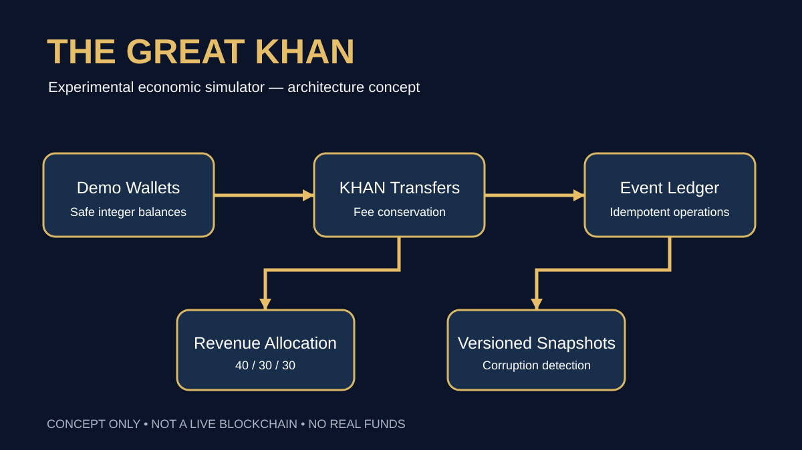

# The Great Khan — Master Business Plan (2026–2031)
**Status:** strategic scenario, not investment solicitation. **All forecasts are illustrative assumptions, not verified market facts.** This document is the GitHub-native source summary; an expanded 100+ page illustrated PDF is prepared separately.

## Executive decision
The Great Khan is currently an open-source **simulated economy**. The repository has deterministic KHAN accounting, wallet validation, transfer fee conservation, idempotent in-memory transaction ledger, experimental snapshot persistence, tests and CI. It is NOT a live cryptocurrency, public chain, secure custody platform, regulated financial institution, or complete Android app. The plan is to validate the simulator before deciding whether any real-value infrastructure is justified.

## Product / customer value
- **People:** learn economic governance and simulate transparent community funding without financial exposure.
- **Businesses:** explore hypothetical token issuance, loyalty and merchant participation; no current payment processing.
- **Developers / researchers:** audit and test reproducible economic rules.
- **Commons:** infrastructure stewardship under transparent constraints.

## Problem and opportunity hypotheses
Community finance is often opaque, hard to audit and intimidating to nontechnical participants. A mobile-first educational simulator could help people evaluate tradeoffs before deploying money. These are hypotheses requiring interviews, usability trials and market evidence; no unsupported TAM/SAM/SOM is asserted.

## Competitive alternatives
Spreadsheets, open-source ledger demos, crypto wallets, DAO voting interfaces, learning simulators and traditional cooperative management. Differentiation must be demonstrated through accessible mobile UX, transparent rules and documented human oversight, not token hype.

## Three-pillar model
Default split: 40% KHAN Commons, 30% People, 30% Businesses of **net distributable protocol revenue**, after eligible costs and exclusions. Locked reserves, principal, user balances and restricted funds cannot be redistributed. Governance must approve policy changes with documented rights protections.

## Operating model
Product owner owns scope and release decisions; engineering maintains domain invariants and CI; independent security reviewers examine custody/authorization risks; finance/compliance owns accounting and regulatory gates; community council proposes and reviews allocations. Separate author, approver and executor; audit every privilege escalation.

## Technology
Current modules: `src/domain/revenue.ts`, `transfers.ts`, `wallets.ts`, `ledger.ts`, `persistence.ts`. All monetary amounts are safe integers; BigInt intermediates protect calculations. Current persistence uses a **noncryptographic checksum**, suitable only for accidental corruption detection, not authenticity. A future backend requires database atomicity, signatures, authorization, audit trails, recovery and threat modeling. A blockchain is a distinct research and investment decision.

## Milestone roadmap
**0–3 months:** CI stability, integrity invariants, tamper-evident ledger, verified replay, mobile UX prototype, 10–20 research participants.
**3–6 months:** accessibility, security model, governance roles, community proposals, token simulation and browser integration.
**6–12 months:** closed pilot, independent code review, governance transparency reports, privacy assessment, compliance consultation.
**12–24 months:** assess whether demand warrants production-grade backend; any real-money scope requires regulatory and security approval.
**24–60 months:** scale only if validated adoption, operating capacity and compliance permit. No promised chain launch date.

## Business model scenarios
Initial product is free and educational. Potential later revenue sources (subject to consent, utility and law): business simulation subscriptions, paid enterprise training, hosted governance tooling and service support. Do not monetize real-value transfers without legal review. Unit economics must separately model acquisition cost, support, hosting, audit and fraud loss.

## Financial model — assumptions, not forecasts
Model 3 scenarios with explicit inputs: active organizations, annual subscription price, conversion rate, gross margin, support cost, engineering payroll, infrastructure, security audits and acquisition costs. Example only: 50 paying organizations × €240/year = €12,000 annual gross subscription revenue **before costs, tax and churn**. Downside: 0 paying organizations. Base and upside must not be presented as validated revenue. Model runway monthly; set hiring and advertising budgets only after funding approval.

## Marketing and advertising
Positioning: “Explore a transparent community economy in simulation.” Creative tracks: transparency, people and businesses, developer education. Organic GitHub and technical explainers precede paid ads. Avoid “investment,” “returns,” “live token,” and “secure blockchain” claims. Ads must prominently disclose **SIMULATION / NO REAL FUNDS**. Test qualified documentation visits and demo completion, not speculative wallet signups. Campaigns require privacy, legal and budget approval.

## Risk register
- Critical: misleading financial claims -> prominent disclaimers and counsel review.
- Critical: unauthorized allocations -> role separation, audit and security tests.
- High: corrupted local state -> validation, backups and recovery.
- High: double spending -> database transactions and uniqueness constraints.
- High: governance capture -> quorum, appeals, anti-sybil and transparent voting.
- High: user privacy -> data minimization and retention controls.
- Medium: marketing waste -> small opt-in experiments and stop-loss budgets.
- Medium: performance -> low-end Android benchmarking.

## KPIs / gates
Technical: conservation property tests, CI reliability, critical vulnerability count, recovery success. Product: onboarding completion, accessibility defects, usability task success, 7-day return. Business: verified willingness to pay, paid conversion, contribution margin, support load. Governance: proposal review time, audit completeness and dispute outcomes. **Do not conflate simulated activity with economic traction.**

## Supporting documentation
[Technical implementation](TECHNICAL_IMPLEMENTATION.md) · [Management](PRODUCT_MANAGEMENT.md) · [Marketing](MARKETING_STRATEGY.md) · [Advertising](ADVERTISING_PLAYBOOK.md) · [Economy](TRI_PILLAR_ECONOMY.md) · [Governance](HISTORICAL_GOVERNANCE.md).
